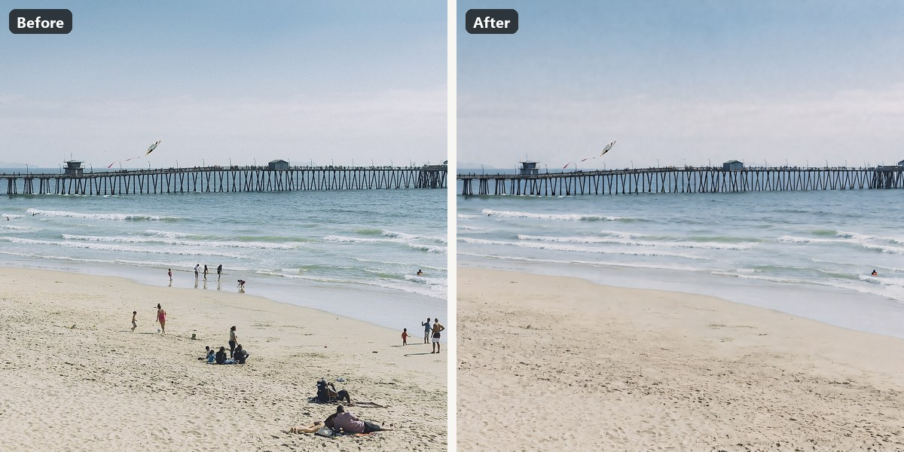
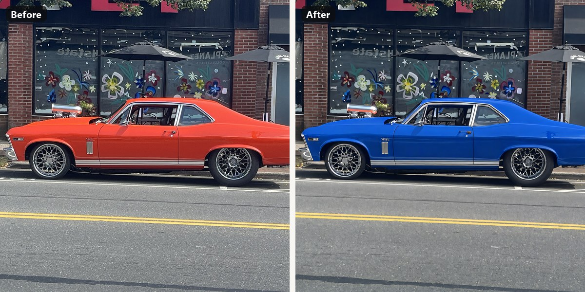
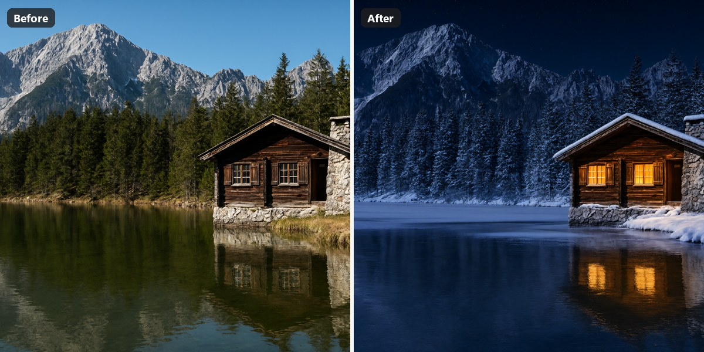
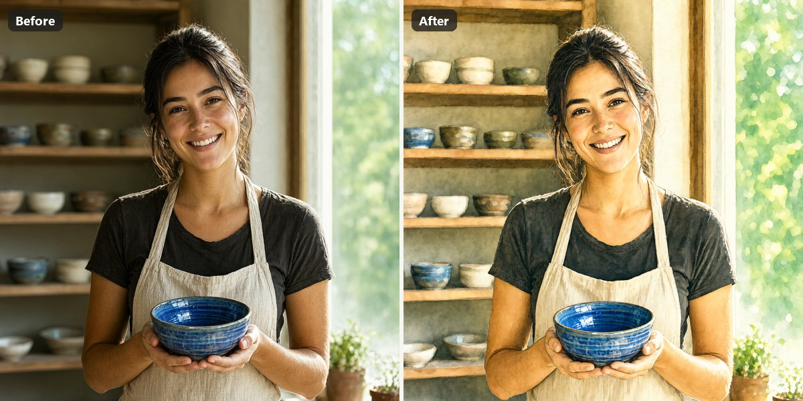
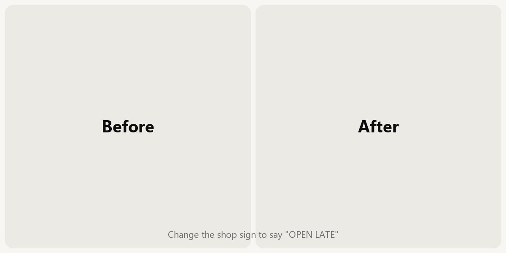
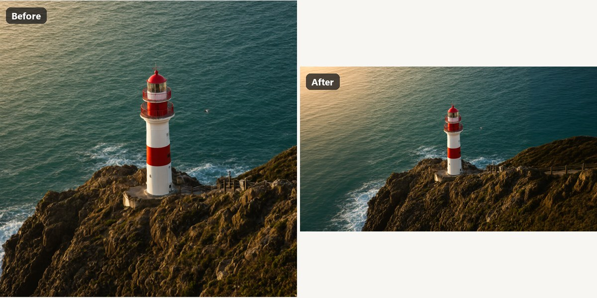
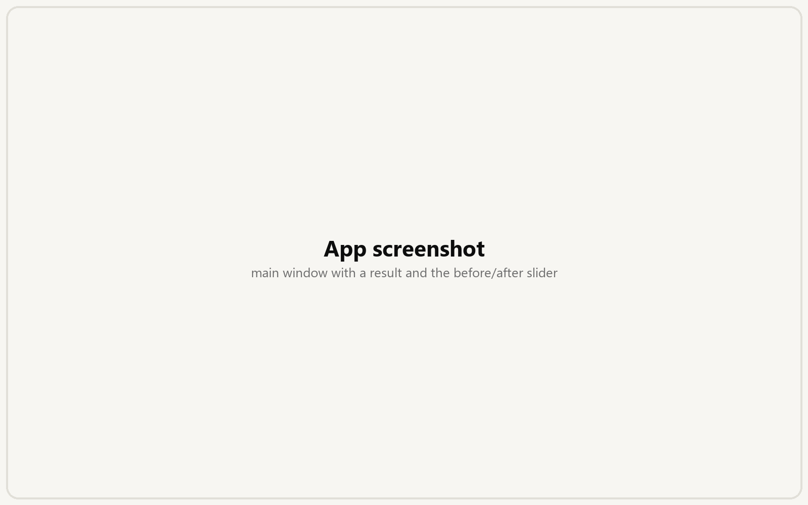
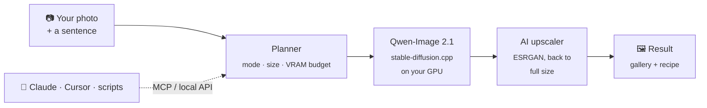
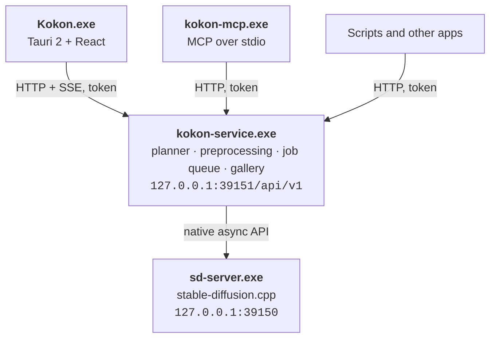
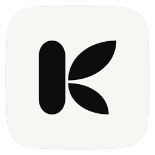

<p align="center">
  <picture>
    <source media="(prefers-color-scheme: dark)" srcset="assets/brand/logo/kokon-logo-white.svg">
    
  </picture>
</p>

<h3 align="center">Edit photos by describing the change, on your own GPU.</h3>

<p align="center">
  One installer, no Python, no cloud. Powered by Qwen-Image 2.1, and ready for your AI agent.
</p>

<p align="center">
  <a href="https://github.com/GabrieleLozupone/kokon/releases/latest"></a>
  <a href="https://github.com/GabrieleLozupone/kokon/releases"></a>
  
  
  <a href="#use-it-from-your-ai-agent"></a>
  <a href="LICENSE"></a>
  <a href="https://github.com/GabrieleLozupone/kokon/stargazers"></a>
</p>

<p align="center">
  <a href="#install">Install</a> ·
  <a href="#what-you-can-do">Features</a> ·
  <a href="#examples">Examples</a> ·
  <a href="#use-it-from-your-ai-agent">AI agents</a> ·
  <a href="#faq">FAQ</a> ·
  <a href="docs/engineering-notes.md">How it works</a>
</p>

https://github.com/user-attachments/assets/f954c20e-eb07-4bc8-8216-b8a412860e99

<p align="center">
  <a href="https://github.com/GabrieleLozupone/kokon/releases/latest"><picture>
    <source media="(prefers-color-scheme: dark)" srcset="assets/readme/download-windows-dark.svg">
    
  </picture></a>
  <a href="#roadmap"><picture>
    <source media="(prefers-color-scheme: dark)" srcset="assets/readme/download-macos-dark.svg">
    
  </picture></a>
  <a href="#roadmap"><picture>
    <source media="(prefers-color-scheme: dark)" srcset="assets/readme/download-linux-dark.svg">
    
  </picture></a>
  <br>
  <sub>Free and open source · about 12 GB of models downloaded on first run · nothing leaves your PC</sub>
</p>

---

## Why Kokon

<table>
  <tr>
    <td width="33%" valign="top">
      <h3>✍️ Just describe it</h3>
      “Remove all the people from the beach.” “Make it golden hour.” Kokon picks the mode, the
      resolution and the memory settings for you. There are no sliders to learn.
    </td>
    <td width="33%" valign="top">
      <h3>🔒 Private by design</h3>
      Everything runs on your own GPU. No account, no uploads, no telemetry. After setup,
      Kokon talks only to <code>127.0.0.1</code>. A private mode keeps nothing at all.
    </td>
    <td width="33%" valign="top">
      <h3>📦 One installer</h3>
      A native app built on <a href="https://github.com/leejet/stable-diffusion.cpp">stable-diffusion.cpp</a>.
      No Python, no ComfyUI, no node graphs. The first run detects your GPU and downloads the
      right model, then verifies it.
    </td>
  </tr>
  <tr>
    <td width="33%" valign="top">
      <h3>🎯 Edits that stay in place</h3>
      Paint over an area and choose Change, Remove, Replace or Add. Kokon shows the model
      exactly where to work, so the rest of the photo stays untouched.
    </td>
    <td width="33%" valign="top">
      <h3>🖼️ Full-size results</h3>
      Kokon keeps your photo's size and aspect ratio, and enlarges with an AI upscaler
      instead of blurry resizing. It also opens iPhone HEIC photos, HDR included.
    </td>
    <td width="33%" valign="top">
      <h3>🤖 Works with your AI agent</h3>
      A built-in MCP server and local HTTP API let Claude, Cursor or your own scripts create
      and edit images on your machine.
    </td>
  </tr>
</table>

## Examples

<p align="center">
  
  <br>
  <sub>One project from the demo video, made in six steps: generate the Colosseum, rebuild it out of pasta,
  add a tomato sauce river, generate the kitchen, combine the two, expand to 21:9.</sub>
</p>

Every result below came from one sentence in Kokon, with default settings.

| | |
| :---: | :---: |
| <br>**Remove** · *“Remove all the people from the beach”* | <br>**Replace** · *“Replace the orange car with a blue vintage Vespa scooter”* |
| <br>**Relight** · *“Make it golden hour, warm low sunlight”* | <br>**Restyle** · *“Turn it into a watercolor illustration”* |
| <br>**Text** · *“Change the neon sign to say ‘OPEN LATE’”* | <br>**Expand** · Expand → 16:9 · *“continue the beach”* |

## Install

**1. Download** `Kokon Setup.exe` from the [latest release](https://github.com/GabrieleLozupone/kokon/releases/latest) and run it. It installs for your user only, so you don't need administrator rights.

**2. Set up models.** On first launch Kokon shows your GPU, VRAM and RAM, recommends a preset
and downloads everything it needs. The download resumes if it is interrupted and every file
is checked against its SHA-256 checksum. On a fast connection the whole thing takes a few minutes.

**3. Edit.** Drop or paste a photo, describe the change and press <kbd>Enter</kbd>.

### Requirements

| | Minimum | Recommended |
| --- | --- | --- |
| **OS** | Windows 10 64-bit | Windows 11 |
| **GPU** | NVIDIA, 12 GB VRAM (RTX 3060 12 GB, 4070) · AMD / Intel 12 GB+ through Vulkan (beta) | NVIDIA, 16 GB+ VRAM (RTX 4080, 5070 Ti, 5080, 4090, 5090) |
| **RAM** | 16 GB | 32 GB |
| **Disk** | 15 GB free | 25 GB free on an SSD |
| **Time per edit** <!-- TODO re-measure at CFG 1 before launch; RTX 5070 12 GB not timed yet --> | A little slower than the RTX 5070 Ti on a 12 GB RTX 5070 | About 1 minute at Balanced on a 16 GB RTX 5070 Ti |

> [!NOTE]
> NVIDIA cards run on the CUDA engine, the fastest and tested path. AMD and Intel cards use the
> **Vulkan engine (beta)**: it works on NVIDIA, but nobody has tried it on a real AMD or Intel
> card yet, so please [report how it goes](https://github.com/GabrieleLozupone/kokon/issues).
> Vulkan is slower than CUDA, and its first image takes longer. Apple Silicon Macs are in
> testing ([platforms](docs/platforms.md)).

<details>
<summary><b>Model presets: what gets downloaded</b></summary>
<br>

The setup screen picks a preset from your VRAM. You can change it later from Settings → Models → **Set up models…**

| Preset | Diffusion model | Text encoder (in RAM) | Download | Tested on real hardware |
| --- | --- | --- | --- | --- |
| 12 GB | Qwen-Image 2.1 Q4_K_M (4.2 GB) | Qwen3-VL 8B Q4_K_M | ~12 GB | ✅ RTX 5070 (12 GB) |
| 16 GB | Qwen-Image 2.1 Q4_K_M | Qwen3-VL 8B Q4_K_M | ~12 GB | ✅ RTX 5070 Ti |
| 24 GB | Qwen-Image 2.1 Q8_0 (7.6 GB) | Qwen3-VL 8B Q4_K_M | ~15 GB | not yet |
| 32 GB+ | Qwen-Image 2.1 Q8_0 | Qwen3-VL 8B Q8_0 (8.7 GB) | ~19 GB | not yet |

Every preset also gets stable-diffusion.cpp (the CUDA 12 build on NVIDIA, the Vulkan build on AMD and Intel), the Qwen-Image 2.1 VAE, the
Qwen3-VL vision projector and, optionally, the 4x-UltraSharp upscaler. The sources are the
official [Qwen-Image 2.1](https://huggingface.co/Qwen/Qwen-Image-2.1) weights through
[unsloth/Qwen-Image-2.1-GGUF](https://huggingface.co/unsloth/Qwen-Image-2.1-GGUF),
[Qwen/Qwen3-VL-8B-Instruct-GGUF](https://huggingface.co/Qwen/Qwen3-VL-8B-Instruct-GGUF) and
[Comfy-Org/Qwen-Image-2.1](https://huggingface.co/Comfy-Org/Qwen-Image-2.1).

Files go to `%LOCALAPPDATA%\KokonData\sdcpp` by default. You can point the setup screen at an
existing stable-diffusion.cpp folder instead; files that are already there are kept.
Other weights, such as fine-tunes, can be selected in Settings → Models.

</details>

## What you can do

| You give Kokon | It does | |
| --- | --- | --- |
| A sentence | **Create** a new image | Aspect ratio from the prompt or the aspect menu |
| A photo + a sentence | **Edit** it | Original size and aspect ratio are kept |
| Several photos + a sentence | **Combine** them | Refer to them as “image 1”, “image 2”… and drag to reorder |
| A brushed area + an action | **Inpaint**: Change, Remove, Replace or Add | Remove needs no prompt |
| Dragged edges | **Expand** the photo (outpainting) | Or type pixel or percent values |
| Any result | **Upscale** to 2×, 4K, the source size or a custom width | Quick (seconds) or Detailed (about a minute) |

<p align="center">
  
</p>

Every result can be edited again, varied, used as a reference, upscaled, saved, copied or
opened in Explorer. A few things make that loop fast:

- **Before/after**: compare with Slider, Flicker or Changes, or hold <kbd>B</kbd> to see the original.
- **Undo/redo between versions** with <kbd>Ctrl</kbd>+<kbd>Z</kbd> / <kbd>Ctrl</kbd>+<kbd>Y</kbd>.
  Undo returns to the version the current one came from, and nothing is ever deleted.
- **Gallery**: every image keeps its full recipe (prompt, seed, settings, pipeline) and reopens
  with one click. The recipe is also embedded in the PNG.
- **Quality presets**: Fast, Balanced, Quality (native 2K) and Ultra (native 2K with the
  official 40 steps), so you never need to tune steps or guidance.

## How it works



The planner decides what kind of job your request is, picks a working size that fits your GPU
and runs a single diffusion pass. When the result has to be larger than what the model rendered,
it is enlarged with ESRGAN instead of a plain resize. For brushed edits, Kokon marks the area on
a second reference image so the model knows exactly where to work. Without that, Qwen-Image 2.1
cannot see the mask.

Want the details? The [engineering notes](docs/engineering-notes.md) cover the architecture,
the measured backend settings and the reasons behind each default.

## Use it from your AI agent

Kokon ships `kokon-mcp.exe`, an [MCP](https://modelcontextprotocol.io) server. Register it once
with Claude Code:

```powershell
claude mcp add --scope user kokon -- "$env:LOCALAPPDATA\Kokon\kokon-mcp.exe"
```

Then ask: *“Generate a hero image for this README and save it in docs/”* or *“Remove the
background clutter from screenshot.png”*. The app doesn't need to be open, because the MCP server
starts the engine on demand. The first call takes about a minute while the model loads.

**Tools:** `generate_image` · `edit_image` · `edit_images` · `inpaint_image` · `outpaint_image` · `upscale_image` · `get_image_info` · `get_generator_status`

<details>
<summary><b>Other MCP hosts (JSON config)</b></summary>
<br>

Project-scoped `.mcp.json`, or any host that takes the standard format:

```json
{
  "mcpServers": {
    "kokon": {
      "type": "stdio",
      "command": "C:\\Users\\<you>\\AppData\\Local\\Kokon\\kokon-mcp.exe",
      "args": []
    }
  }
}
```

Same thing from the command line:

```powershell
claude mcp add-json --scope user kokon '{"type":"stdio","command":"C:\\Users\\<you>\\AppData\\Local\\Kokon\\kokon-mcp.exe","args":[]}'
```

</details>

<details>
<summary><b>MCP behavior and safety</b></summary>
<br>

- Every result returns the absolute path of the saved file, its size, seed and generation metadata.
- Paths may be absolute or relative to the project (`CLAUDE_PROJECT_DIR`). Reads and writes are
  limited to the project folder, Kokon's output folder and folders listed in
  `QLS_MCP_ALLOWED_DIRS` (separated by semicolons). Existing files are never overwritten.
- Images are **not** sent back to the model by default; they stay on disk. Pass
  `include_preview: true` to include a small JPEG preview.
- `upscale_image` takes `scale` (default 2) or `width`/`height` (up to 8192 px), and
  `method` (`quick` | `detailed`).
- Progress is reported through MCP progress notifications. Claude Code's default tool timeout is
  30 minutes (`MCP_TOOL_TIMEOUT`).
- Without the desktop window open, the model is unloaded after 15 idle minutes (Settings → General).

</details>

<details>
<summary><b>Local HTTP API</b></summary>
<br>

Base URL `http://127.0.0.1:39151/api/v1`. Every call except `/ping` needs
`Authorization: Bearer <token>`, with the token from `%LOCALAPPDATA%\KokonData\service.json`.
Requests that carry a browser `Origin` header are refused.

```powershell
$i = Get-Content "$env:LOCALAPPDATA\KokonData\service.json" | ConvertFrom-Json
$h = @{ Authorization = "Bearer $($i.token)" }
Invoke-RestMethod -Method Post "http://127.0.0.1:$($i.port)/api/v1/generate" -Headers $h `
  -ContentType 'application/json' -Body '{"prompt":"a lighthouse at dusk, 16:9","quality":"fast"}'
```

| Method | Path | Purpose |
| --- | --- | --- |
| GET | `/ping` | Liveness (no auth) |
| GET | `/status` | Server state, model, GPU/VRAM, active job, queue |
| POST | `/generate`, `/edit`, `/inpaint`, `/outpaint`, `/upscale` | Simple operations; wait for the result unless `?wait=false` |
| POST | `/jobs` | Full request (see `GenerationRequest` in `planner.rs`) |
| GET | `/jobs/{id}`, `/jobs/{id}/wait?timeout=60` | Job status / long-poll |
| POST | `/jobs/{id}/cancel` | Cancel |
| POST | `/plan` | Dry run: resolved mode, working/output size, notes |
| GET | `/events` | Server-sent events (jobs, server, gallery) |
| GET | `/gallery`, `/gallery/{id}`, `/gallery/{id}/image` | Gallery |
| POST | `/image-info` | Size, aspect, type, embedded generation metadata |

Simple-operation fields: `prompt`, `image` / `images[]`, `mask`, `action`
(`edit|remove|replace|add`, inpainting), `width`, `height`, `aspect_ratio`, `quality`
(`fast|balanced|quality`), `seed`, `output_path`, `preserve_dimensions`, `private`,
`left/right/top/bottom` + `units` (`pixels|percent`) for outpainting, `scale` and `method`
(`quick|detailed`) for upscaling. Full requests (`/jobs`) also accept `"mode": "upscale"` with
`"upscale": {"method", "scale" | "width"/"height"}` and `"advanced": {"refine": "fast|best"}`.

</details>

## Privacy

Kokon makes only two kinds of network request:

- **Setup:** `github.com` for the stable-diffusion.cpp release and `huggingface.co` for the
  models.
- **Update check:** at most once a day, the app fetches `latest.json` from this repository's
  latest GitHub release, a small file with the newest version number. Nothing about you or your
  images is sent. Turn it off on the welcome screen or in Settings → General. Updates are
  downloaded only when you click **Update**, and installed only if their signature matches the
  key built into the app.

Creating, editing, the gallery, the MCP server and the API talk to `127.0.0.1` only. Logs never
contain your prompts.

You can check this yourself. While you work, watch `Kokon.exe`, `kokon-service.exe` and
`sd-server.exe` in Resource Monitor (Network tab), or run
`Get-NetTCPConnection -OwningProcess <pid>`.

**Private mode** (the eye icon in the top bar) keeps images and prompts out of the gallery, the
output folder and the project list. They are deleted when you turn private mode off, close the
window, or restart the service. **Save as…** still writes a copy wherever you choose.

## How it compares

Kokon does one thing: editing photos with Qwen-Image 2.1, with as little setup as possible.
If you want full control over every node, ComfyUI is the better tool.

| | **Kokon** | ComfyUI + Qwen workflow | Krita AI Diffusion | Other Qwen web UIs |
| --- | :---: | :---: | :---: | :---: |
| Install | One `.exe` | Python environment + nodes | Krita + plugin + ComfyUI | Python or ComfyUI |
| Picks size and memory settings for you | ✅ | ❌ | partly | partly |
| Brush edits the model can see | ✅ | depends on the workflow | ✅ | rarely |
| MCP server for AI agents | ✅ | community nodes | ❌ | ❌ |
| AMD / Intel GPUs | beta (Vulkan) | ✅ | ✅ | varies |
| Custom pipelines, node graphs | ❌ | ✅ | partly | ❌ |
| Painting and layers | ❌ | ❌ | ✅ | ❌ |

## FAQ

<details>
<summary><b>Windows says “Windows protected your PC”</b></summary>
<br>

SmartScreen shows this for new apps that don't have a download history yet. Click
**More info → Run anyway**. You can check the installer against the SHA-256 hash listed in the
release notes, or [build it yourself](#build-from-source).

</details>

<details>
<summary><b>Do I need an internet connection?</b></summary>
<br>

Only once, to download the models. After that Kokon works fully offline.

</details>

<details>
<summary><b>Does it work on AMD or Intel GPUs, or on a Mac?</b></summary>
<br>

AMD and Intel: in beta. The setup screen installs stable-diffusion.cpp's Vulkan build for
them, which uses the graphics driver you already have. It works on NVIDIA cards, but it has not
been verified on a real AMD or Intel card yet; integrated graphics are not supported. Please
[open an issue](https://github.com/GabrieleLozupone/kokon/issues) with your card and how it went.

Mac: Apple Silicon support is in testing. See [docs/platforms.md](docs/platforms.md) for the
planned requirements (24 GB of unified memory recommended).

</details>

<details>
<summary><b>My GPU has 8 GB. Can I still use it?</b></summary>
<br>

Not with good results today. Qwen-Image 2.1 is a large model, and 12 GB is the smallest size
Kokon is designed for. Smaller cards may come with lighter models in the future.

</details>

<details>
<summary><b>Can I use Kokon commercially?</b></summary>
<br>

Kokon's code is open source (see [License](#license)). The models have their own licenses:
Qwen-Image 2.1 is released under the Qwen license (see the
[model page](https://huggingface.co/Qwen/Qwen-Image-2.1)), and the optional 4x-UltraSharp
upscaler is CC BY-NC-SA 4.0, which means non-commercial use only. Check each license for your
use case.

</details>

<details>
<summary><b>iPhone photos (HEIC) and HDR</b></summary>
<br>

HEIC/HEIF photos open like any other image. They are decoded by Windows, so Microsoft's
**HEIF Image Extensions** and **HEVC Video Extensions** must be installed.

iPhone photos with an HDR gain map (iOS 18+) show a **Keep HDR** switch in Advanced, which is on
by default. Edits of such photos are saved as **Ultra HDR JPEG**: Chrome, Edge, Android and
recent Apple systems show them in HDR, and every other viewer shows a normal JPEG. This needs
`ffmpeg` 7.1+ on PATH; without it the result is saved in SDR and the job's notes say why.

</details>

<details>
<summary><b>Which upscaler is used, and can I change it?</b></summary>
<br>

Settings → Models offers two ESRGAN models: **UltraSharp** (default, downloaded by the setup
screen) and **Superscale-SP**. To use Superscale-SP, put
`4x_NMKD-Superscale-SP_178000_G.pth` from
[uwg/upscaler](https://huggingface.co/uwg/upscaler/tree/main/ESRGAN) into
`<stable-diffusion.cpp folder>\models\upscalers\`. Without an upscaler everything still works,
with a plain resize instead.

</details>

<details>
<summary><b>Where are my images and settings stored?</b></summary>
<br>

| What | Where |
| --- | --- |
| Images | `%USERPROFILE%\Pictures\Kokon\<date>\` (configurable) |
| Settings | `%APPDATA%\Kokon\config.json` |
| Gallery database, inputs, thumbnails, logs | `%LOCALAPPDATA%\KokonData\` |
| Models (default) | `%LOCALAPPDATA%\KokonData\sdcpp\` |
| API port and token | `%LOCALAPPDATA%\KokonData\service.json` |

</details>

<details>
<summary><b>How do I uninstall it?</b></summary>
<br>

Use **Settings → Apps → Installed apps → Kokon → Uninstall**. Your images stay in your Pictures
folder. To free the model space too, delete `%LOCALAPPDATA%\KokonData`.

</details>

<details>
<summary><b>Something went wrong</b></summary>
<br>

If a download fails, the setup screen shows the file's download page and target folder so you
can fetch it by hand. For anything else, please
[open an issue](https://github.com/GabrieleLozupone/kokon/issues/new) with your GPU, driver version and
the log from `%LOCALAPPDATA%\KokonData\logs`.

</details>

## Roadmap

- [x] Create, edit, combine, brush edits, expand, upscale
- [x] First-run setup with GPU detection and verified, resumable downloads
- [x] MCP server and local HTTP API
- [x] Before/after, version undo, private mode, HEIC and HDR
- [ ] Fast mode with a turbo LoRA (an edit in about 15 seconds)
- [ ] AMD and Intel GPUs through Vulkan (beta now; works on NVIDIA, to verify on AMD/Intel)
- [ ] Background removal and transparent cutouts
- [ ] Batch edits: one instruction for a whole folder
- [ ] Plugins for Krita, GIMP and Photoshop through the local API
- [ ] macOS on Apple Silicon (in testing), then Linux

Have an idea? [Start a discussion](https://github.com/GabrieleLozupone/kokon/discussions) or 👍 an existing one.

## Build from source

<details>
<summary><b>Requirements and commands</b></summary>
<br>

You need Rust (stable, MSVC), Node 22+, Visual Studio Build Tools and WebView2.

```powershell
npm install
cargo test -p qls-core            # core unit tests
npx vitest run                    # UI logic tests
cd mcp; npx vitest run; cd ..     # MCP tests (includes a stdio protocol test)
npx tauri dev                     # run the desktop app in development
powershell -ExecutionPolicy Bypass -File scripts\build-release.ps1   # installer
```

</details>

<details>
<summary><b>Architecture</b></summary>
<br>



The Rust core (`crates/qls-core`) holds all the logic: geometry, image processing, planning,
the inference adapter, the job queue and the gallery. The service, the desktop app and the
MCP server are thin layers on top. See the [engineering notes](docs/engineering-notes.md)
for a module map and the backend facts each default is based on.

</details>

## Contributing

Bug reports, translations, example prompts and pull requests are all welcome. Issues tagged
[good first issue](https://github.com/GabrieleLozupone/kokon/labels/good%20first%20issue) are a good
place to start. Please run the tests above before opening a pull request.

## Responsible use

Kokon edits real photos. Don't use it to deceive, harass or impersonate people, or to make
images of someone without their consent. You are responsible for what you create and share.

## License

Kokon's source code is released under the [GNU Affero General Public License v3.0](LICENSE) (AGPL-3.0-only). Model weights and the
upscaler are downloaded from their authors and keep their own licenses (see the
[FAQ](#faq)).

Kokon builds on [stable-diffusion.cpp](https://github.com/leejet/stable-diffusion.cpp) by
leejet, [Qwen-Image 2.1](https://huggingface.co/Qwen/Qwen-Image-2.1) by the Qwen team,
[Unsloth](https://huggingface.co/unsloth)'s GGUF conversions, [Tauri](https://tauri.app) and
4x-UltraSharp by Kim2091. Thank you.

<p align="center">
  <br>
  
  <br>
  <sub>Made for people who would rather type a sentence than wire up a pipeline.</sub>
</p>
